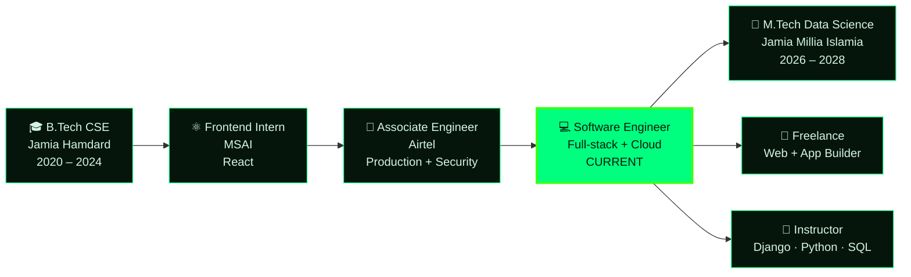

<!--
  ✏️ BEFORE YOU PUSH — search & replace:
     YOUR_USERNAME      -> your GitHub username
     YOUR_PORTFOLIO_URL -> your portfolio link (without https://)
     YOUR_LINKEDIN / YOUR_EMAIL / YOUR_CHANNEL / REPO_ONE..REPO_THREE
  Repo name must be EXACTLY your username (public repo) for this to show on your profile.
-->

<div align="center">

<!-- ════════════════════ HERO ════════════════════ -->


<a href="https://github.com/YOUR_USERNAME">
  
</a>

<br/>


<br/>


<a href="https://github.com/YOUR_USERNAME?tab=followers"></a>
<a href="https://github.com/YOUR_USERNAME?tab=repositories"></a>
<a href="https://github.com/YOUR_USERNAME?tab=stars"></a>

<br/><br/>

<a href="https://YOUR_PORTFOLIO_URL"></a>
<a href="https://linkedin.com/in/YOUR_LINKEDIN"></a>
<a href="mailto:YOUR_EMAIL@example.com"></a>
<a href="https://youtube.com/@YOUR_CHANNEL"></a>

</div>


<!-- ════════════════════ ABOUT ════════════════════ -->

## 🖥️ `$ cat about.txt`

```python
class MohdKaif:
    role       = "Software Engineer"
    studying   = "M.Tech in Data Science  @ Jamia Millia Islamia  (2026-2028)"
    graduated  = "B.Tech in CSE           @ Jamia Hamdard          (2020-2024)"
    worked_at  = ["Airtel (Associate Engineer)", "MSAI (Frontend Intern)"]
    freelance  = ["Websites", "Web Apps", "Mobile Apps"]
    teaches    = ["Django", "Python", "SQL"]   # day-wise video courses
    location   = "New Delhi, India 🇮🇳"

    def mission(self):
        return "Build practical software. Teach what I learn."
```

> 💬 I build practical products across **frontend, backend, full-stack and cloud**, and I make **day-wise video courses** so beginners can learn Django, Python and SQL step by step.


<!-- ════════════════════ EDUCATION ════════════════════ -->

## 🎓 `$ ls ./education`

<div align="center">

<table>
<tr>
<td align="center" width="50%">


### Jamia Millia Islamia
**M.Tech — Data Science**

📍 New Delhi &nbsp;•&nbsp; 🗓️ 2026 – 2028


</td>
<td align="center" width="50%">


### Jamia Hamdard
**B.Tech — Computer Science & Engineering**

📍 New Delhi &nbsp;•&nbsp; 🗓️ 2020 – 2024


</td>
</tr>
</table>

</div>


<!-- ════════════════════ JOURNEY ════════════════════ -->

## 🧭 `$ git log --graph`



| Commit | Role | Where | What I did |
|:--|:--|:--|:--|
| 🟢 `#current` | **M.Tech, Data Science** | Jamia Millia Islamia | Pursuing 2026 – 2028 |
| 🟢 `#latest` | **Software Engineer** | Current | Full-stack engineering, cloud, production systems |
| ⚪ `airtel` | **Associate Engineer** | Airtel | Production engineering, network security, software systems |
| ⚪ `msai` | **Frontend Developer (Intern)** | MSAI | Frontend development, React-based interfaces |
| ⚪ `edu` | **B.Tech, CSE** | Jamia Hamdard | Foundation in CS, programming and software development |


<!-- ════════════════════ WHAT I DO ════════════════════ -->

## ⚡ `$ ./whatido.sh`

<div align="center">

<table>
<tr>
<td align="center" width="25%"><h3>💻</h3><b>Software Engineer</b><br/><sub>Full-stack, cloud and production systems</sub></td>
<td align="center" width="25%"><h3>🌐</h3><b>Web Builder</b><br/><sub>Fast, clean websites and web apps, idea to deploy</sub></td>
<td align="center" width="25%"><h3>📱</h3><b>App Builder</b><br/><sub>Mobile and cross-platform apps users love</sub></td>
<td align="center" width="25%"><h3>🎥</h3><b>Instructor</b><br/><sub>Day-wise courses: Django, Python, SQL</sub></td>
</tr>
</table>

</div>


<!-- ════════════════════ SKILLS ════════════════════ -->

## 🛠️ `$ cat skills.json`

<div align="center">


<br/>

**Languages**<br/>


**Frontend**<br/>


**Backend**<br/>


**Database & Cloud**<br/>


**Tools**<br/>


</div>


<!-- ════════════════════ PLAYLISTS ════════════════════ -->

## 🎥 `$ ls ./playlists`

<div align="center">

<table>
<tr>
<td align="center" width="50%">


### Django — Day-wise
Setup, virtual env, project structure, apps, URLs, views, templates


</td>
<td align="center" width="50%">


### SQL — Day-wise
Databases, SELECT, WHERE, ORDER BY, filtering data


</td>
</tr>
</table>

<a href="https://YOUR_PORTFOLIO_URL#playlists"></a>

</div>


<!-- ════════════════════ STATS ════════════════════ -->

## 📊 `$ ./stats.sh`

<div align="center">


<br/>


<br/>


</div>


<!-- ════════════════════ ACTIVITY ════════════════════ -->

## 📈 `$ ./activity.sh`

<div align="center">


</div>


<!-- ════════════════════ TROPHIES + PINNED ════════════════════ -->

## 🏆 `$ ./trophies.sh`

<div align="center">


</div>

## 📌 `$ ls ./pinned`

<div align="center">

<a href="https://github.com/YOUR_USERNAME/REPO_ONE"></a>
<a href="https://github.com/YOUR_USERNAME/REPO_TWO"></a>
<br/>
<a href="https://github.com/YOUR_USERNAME/REPO_THREE"></a>

</div>


<!-- ════════════════════ CONTACT ════════════════════ -->

## 🤝 `$ ./contact.sh`

<div align="center">


<br/>

<a href="https://YOUR_PORTFOLIO_URL#contact"></a>
<a href="mailto:YOUR_EMAIL@example.com"></a>

<br/><br/>


<sub><code>exit 0</code> &nbsp;//&nbsp; ⭐ star if you liked this profile</sub>

</div>
